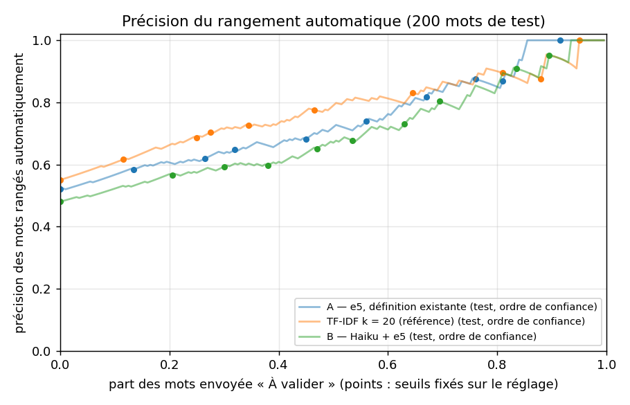

# Point 5 — Résultats sur les 200 mots de test

## A — e5, définition existante

k = 5 ; 200 mots de test.

- Bonne section en tête : **52,0 % [45,0 % ; 59,0 %]**
- Bonne section dans les 3 premières : **67,5 % [61,0 % ; 74,0 %]**

### Courbe « À valider » (seuils fixés sur les 100 mots de réglage)

| part visée | seuil de confiance | part envoyée « À valider » (test) | mots rangés seuls | précision des mots rangés seuls [IC 95 %] |
|---|---|---|---|---|
| 0 % | -inf | 0,0 % | 200 | 52,0 % [45,0 % ; 59,0 %] |
| 10 % | 0.202 | 13,5 % | 173 | 58,4 % [50,9 % ; 65,9 %] |
| 20 % | 0.398 | 26,5 % | 147 | 61,9 % [53,7 % ; 69,4 %] |
| 30 % | 0.400 | 32,0 % | 136 | 64,7 % [56,6 % ; 72,8 %] |
| 40 % | 0.401 | 45,0 % | 110 | 68,2 % [59,1 % ; 76,4 %] |
| 50 % | 0.405 | 56,0 % | 88 | 73,9 % [64,8 % ; 83,0 %] |
| 60 % | 0.600 | 67,0 % | 66 | 81,8 % [72,7 % ; 90,9 %] |
| 70 % | 0.603 | 76,0 % | 48 | 87,5 % [77,1 % ; 95,8 %] |
| 80 % | 0.798 | 81,0 % | 38 | 86,8 % [76,3 % ; 97,4 %] |
| 90 % | 0.824 | 91,5 % | 17 | 100,0 % [100,0 % ; 100,0 %] |

### Erreurs par nature de mot

| nature | mots | erreurs | taux d'erreur |
|---|---|---|---|
| nom ou expression | 151 | 74 | 49 % |
| description | 38 | 11 | 29 % |
| verbe | 6 | 6 | 100 % |
| adjectif | 5 | 5 | 100 % |

| forme | mots | erreurs | taux d'erreur |
|---|---|---|---|
| mot simple | 123 | 56 | 46 % |
| expression (plusieurs mots) | 77 | 40 | 52 % |

### Erreurs par thème (thèmes avec au moins une erreur)

| thème | mots | erreurs |
|---|---|---|
| Parole, langue et écriture | 17 | 10 |
| Nature, terre et climat | 10 | 7 |
| Corps, santé et médecine | 10 | 7 |
| Les personnes | 15 | 5 |
| Propriétés des choses | 15 | 4 |
| Sports et loisirs | 12 | 4 |
| Architecture, maison et mobilier | 6 | 4 |
| Loi, crime et sanction | 5 | 4 |
| Algorithmes et structures de données | 10 | 3 |
| Apparence, vêtements et mode | 6 | 3 |
| Croyances, religions et sacré | 4 | 3 |
| Design de produit | 3 | 3 |
| Fêtes, nourriture et boissons | 7 | 2 |
| Conflit, guerre et armes | 6 | 2 |
| Économie, argent et métiers | 5 | 2 |
| Voyages et transports | 4 | 2 |
| Arts visuels | 4 | 2 |
| Spectacle, cinéma et médias | 3 | 2 |
| La conduite : règle, excès, maîtrise | 2 | 2 |
| La vie sociale | 2 | 2 |
| Backend | 2 | 2 |
| La parole : dire, débattre, enseigner | 2 | 2 |
| Communication logicielle | 2 | 2 |
| L'esprit | 2 | 2 |
| Terre, ciel et animaux | 7 | 1 |
| Programmation et code | 5 | 1 |
| Animaux | 5 | 1 |
| Informatique générale et électronique | 3 | 1 |
| Matériel | 3 | 1 |
| Frontend | 2 | 1 |
| Musique | 2 | 1 |
| Morale, faute et rachat | 1 | 1 |
| Évaluer autrui : blâme et éloge | 1 | 1 |
| Structures et espaces | 1 | 1 |
| L'expression et le degré | 1 | 1 |
| Conception de systèmes | 1 | 1 |
| Sciences et technologies | 1 | 1 |
| Le lien : échanger, partager, se déplacer | 1 | 1 |
| Affaiblir et détruire | 1 | 1 |

### 10 échecs (les plus confiants d'abord)

| mot | vraie section | section prédite | rang de la vraie | confiance | même thème | recouvrement |
|---|---|---|---|---|---|---|
| **resectable** (résécable (opérable)) | Corps, santé et médecine › Cancer et tumeurs | Corps, santé et médecine › Interventions chirurgicales et médicales et termes associés | >10 | 0.80 | oui | — |
| **border-radius** (arrondi de bordure) | Frontend › formes, typographie, couleurs et unités | Frontend › termes CSS : mise en page (flexbox, grid, positionnement) | 2 | 0.80 | oui | — |
| **MEMS** (MEMS (microsystème électromécanique)) | Informatique générale et électronique › Termes d'électronique | Informatique générale et électronique › Ordinateurs | >10 | 0.80 | oui | — |
| **imbriqué, imbriquée** (interwoven) | La vie sociale › Liens et interactions | Propriétés des choses › Ordre et relation | 2 | 0.80 | non | — |
| **scours** (diarrhée (colibacillose)) | Animaux › Bétail | Animaux › Groupes d'animaux | >10 | 0.80 | oui | 2 mot(s) partagé(s) |
| **revocation** (révocation) | Backend › authentification et autorisation | Sécurité frontend et applicative › cookies, sessions et jetons | 2 | 0.80 | non | — |
| **coronal mass ejection (CME)** (éjection de masse coronale (CME)) | Terre, ciel et animaux › Le système solaire | Sciences et technologies › Soleil | >10 | 0.60 | non | — |
| **chemical weathering** (altération chimique (météorisation chimique)) | Nature, terre et climat › Roches et gemmes | Nature, terre et climat › Géologie et reliefs | >10 | 0.60 | oui | — |
| **daith piercing** (piercing daith) | Apparence, vêtements et mode › Bijoux | Corps, santé et médecine › Oreilles | 2 | 0.60 | non | — |
| **tragus piercing** (piercing du tragus) | Apparence, vêtements et mode › Bijoux | Corps, santé et médecine › Oreilles | 2 | 0.60 | non | — |

## TF-IDF k = 20 (référence)

k = 20 ; 200 mots de test.

- Bonne section en tête : **55,0 % [48,0 % ; 62,0 %]**
- Bonne section dans les 3 premières : **77,0 % [71,0 % ; 83,0 %]**

### Courbe « À valider » (seuils fixés sur les 100 mots de réglage)

| part visée | seuil de confiance | part envoyée « À valider » (test) | mots rangés seuls | précision des mots rangés seuls [IC 95 %] |
|---|---|---|---|---|
| 0 % | -inf | 0,0 % | 200 | 55,0 % [48,0 % ; 62,0 %] |
| 10 % | 0.158 | 11,5 % | 177 | 61,6 % [54,2 % ; 68,4 %] |
| 20 % | 0.212 | 25,0 % | 150 | 68,7 % [61,3 % ; 76,0 %] |
| 30 % | 0.241 | 27,5 % | 145 | 70,3 % [62,8 % ; 77,9 %] |
| 40 % | 0.271 | 34,5 % | 131 | 72,5 % [64,9 % ; 80,2 %] |
| 50 % | 0.320 | 46,5 % | 107 | 77,6 % [69,2 % ; 85,0 %] |
| 60 % | 0.408 | 64,5 % | 71 | 83,1 % [74,6 % ; 91,5 %] |
| 70 % | 0.560 | 81,0 % | 38 | 89,5 % [78,9 % ; 97,4 %] |
| 80 % | 0.682 | 88,0 % | 24 | 87,5 % [75,0 % ; 100,0 %] |
| 90 % | 0.842 | 95,0 % | 10 | 100,0 % [100,0 % ; 100,0 %] |

### Erreurs par nature de mot

| nature | mots | erreurs | taux d'erreur |
|---|---|---|---|
| nom ou expression | 151 | 70 | 46 % |
| description | 38 | 12 | 32 % |
| verbe | 6 | 6 | 100 % |
| adjectif | 5 | 2 | 40 % |

| forme | mots | erreurs | taux d'erreur |
|---|---|---|---|
| mot simple | 123 | 55 | 45 % |
| expression (plusieurs mots) | 77 | 35 | 45 % |

### Erreurs par thème (thèmes avec au moins une erreur)

| thème | mots | erreurs |
|---|---|---|
| Parole, langue et écriture | 17 | 8 |
| Corps, santé et médecine | 10 | 7 |
| Propriétés des choses | 15 | 6 |
| Nature, terre et climat | 10 | 6 |
| Les personnes | 15 | 4 |
| Conflit, guerre et armes | 6 | 4 |
| Architecture, maison et mobilier | 6 | 3 |
| Animaux | 5 | 3 |
| Voyages et transports | 4 | 3 |
| Design de produit | 3 | 3 |
| Sports et loisirs | 12 | 2 |
| Fêtes, nourriture et boissons | 7 | 2 |
| Apparence, vêtements et mode | 6 | 2 |
| Programmation et code | 5 | 2 |
| Économie, argent et métiers | 5 | 2 |
| Croyances, religions et sacré | 4 | 2 |
| Arts visuels | 4 | 2 |
| Informatique générale et électronique | 3 | 2 |
| Spectacle, cinéma et médias | 3 | 2 |
| La conduite : règle, excès, maîtrise | 2 | 2 |
| La vie sociale | 2 | 2 |
| Backend | 2 | 2 |
| La parole : dire, débattre, enseigner | 2 | 2 |
| Communication logicielle | 2 | 2 |
| Algorithmes et structures de données | 10 | 1 |
| Terre, ciel et animaux | 7 | 1 |
| Loi, crime et sanction | 5 | 1 |
| Matériel | 3 | 1 |
| Frontend | 2 | 1 |
| Musique | 2 | 1 |
| Morale, faute et rachat | 1 | 1 |
| Évaluer autrui : blâme et éloge | 1 | 1 |
| Structures et espaces | 1 | 1 |
| Conception de systèmes | 1 | 1 |
| Sciences et technologies | 1 | 1 |
| Le lien : échanger, partager, se déplacer | 1 | 1 |
| Culture générale : notions clés | 1 | 1 |
| Liens humains et société | 1 | 1 |
| Affaiblir et détruire | 1 | 1 |

### 10 échecs (les plus confiants d'abord)

| mot | vraie section | section prédite | rang de la vraie | confiance | même thème | recouvrement |
|---|---|---|---|---|---|---|
| **tom** (matou (chat mâle)) | Animaux › Chats | Animaux › Groupes d'animaux | 3 | 0.81 | oui | 1 mot(s) partagé(s) |
| **amoeboid** (amiboïde) | Propriétés des choses › FORMES PARTICULIÈRES OU RESSEMBLANCES | Terre, ciel et animaux › Adjectifs désignant les animaux | 2 | 0.69 | non | — |
| **revocation** (révocation) | Backend › authentification et autorisation | Sécurité frontend et applicative › cookies, sessions et jetons | 2 | 0.68 | non | — |
| **coronal mass ejection (CME)** (éjection de masse coronale (CME)) | Terre, ciel et animaux › Le système solaire | Sciences et technologies › Soleil | >10 | 0.65 | non | — |
| **accueillir** (to welcome) | Le lien : échanger, partager, se déplacer › Voyage et hébergement | Les personnes › Tempérament et comportement | >10 | 0.52 | non | — |
| **se gaver** (to gorge) | La conduite : règle, excès, maîtrise › Imprudence et excès | Les personnes › Impressions sensorielles : goût | >10 | 0.49 | non | — |
| **savanna** (savane) | Nature, terre et climat › Champs, prairies et marais | Terre, ciel et animaux › Terrain et paysage | 2 | 0.49 | non | — |
| **chemical weathering** (altération chimique (météorisation chimique)) | Nature, terre et climat › Roches et gemmes | Nature, terre et climat › Géologie et reliefs | 8 | 0.47 | oui | — |
| **jibe** (empanner (virer lof pour lof)) | Voyages et transports › Navigation à voile | Sports et loisirs › Planche à voile | 2 | 0.45 | non | 2 mot(s) partagé(s) |
| **tondo** (tondo (tableau rond)) | Arts visuels › Termes d'art | Propriétés des choses › FORMES GÉNÉRALES | >10 | 0.45 | non | — |

## B — Haiku + e5

k = 30 ; 200 mots de test.

- Bonne section en tête : **48,0 % [41,0 % ; 55,0 %]**
- Bonne section dans les 3 premières : **61,0 % [54,5 % ; 68,0 %]**

### Courbe « À valider » (seuils fixés sur les 100 mots de réglage)

| part visée | seuil de confiance | part envoyée « À valider » (test) | mots rangés seuls | précision des mots rangés seuls [IC 95 %] |
|---|---|---|---|---|
| 0 % | -inf | 0,0 % | 200 | 48,0 % [41,0 % ; 55,0 %] |
| 10 % | 0.100 | 20,5 % | 159 | 56,6 % [49,1 % ; 64,2 %] |
| 20 % | 0.101 | 30,0 % | 140 | 59,3 % [50,7 % ; 67,1 %] |
| 30 % | 0.134 | 38,0 % | 124 | 59,7 % [50,8 % ; 68,5 %] |
| 40 % | 0.167 | 47,0 % | 106 | 65,1 % [55,7 % ; 73,6 %] |
| 50 % | 0.168 | 53,5 % | 93 | 67,7 % [58,1 % ; 77,4 %] |
| 60 % | 0.233 | 63,0 % | 74 | 73,0 % [62,2 % ; 82,4 %] |
| 70 % | 0.300 | 69,5 % | 61 | 80,3 % [70,5 % ; 90,2 %] |
| 80 % | 0.435 | 83,5 % | 33 | 90,9 % [78,8 % ; 100,0 %] |
| 90 % | 0.534 | 89,5 % | 21 | 95,2 % [85,7 % ; 100,0 %] |

### Erreurs par nature de mot

| nature | mots | erreurs | taux d'erreur |
|---|---|---|---|
| nom ou expression | 151 | 71 | 47 % |
| description | 38 | 22 | 58 % |
| verbe | 6 | 6 | 100 % |
| adjectif | 5 | 5 | 100 % |

| forme | mots | erreurs | taux d'erreur |
|---|---|---|---|
| mot simple | 123 | 64 | 52 % |
| expression (plusieurs mots) | 77 | 40 | 52 % |

### Erreurs par thème (thèmes avec au moins une erreur)

| thème | mots | erreurs |
|---|---|---|
| Parole, langue et écriture | 17 | 13 |
| Les personnes | 15 | 9 |
| Propriétés des choses | 15 | 8 |
| Sports et loisirs | 12 | 5 |
| Nature, terre et climat | 10 | 5 |
| Algorithmes et structures de données | 10 | 5 |
| Corps, santé et médecine | 10 | 4 |
| Terre, ciel et animaux | 7 | 4 |
| Apparence, vêtements et mode | 6 | 4 |
| Programmation et code | 5 | 3 |
| Design de produit | 3 | 3 |
| Spectacle, cinéma et médias | 3 | 3 |
| Architecture, maison et mobilier | 6 | 2 |
| Conflit, guerre et armes | 6 | 2 |
| Animaux | 5 | 2 |
| Sécurité frontend et applicative | 5 | 2 |
| Économie, argent et métiers | 5 | 2 |
| Croyances, religions et sacré | 4 | 2 |
| Voyages et transports | 4 | 2 |
| Informatique générale et électronique | 3 | 2 |
| La conduite : règle, excès, maîtrise | 2 | 2 |
| La vie sociale | 2 | 2 |
| La parole : dire, débattre, enseigner | 2 | 2 |
| L'esprit | 2 | 2 |
| Fêtes, nourriture et boissons | 7 | 1 |
| Loi, crime et sanction | 5 | 1 |
| Arts visuels | 4 | 1 |
| Backend | 2 | 1 |
| Frontend | 2 | 1 |
| Communication logicielle | 2 | 1 |
| Morale, faute et rachat | 1 | 1 |
| Évaluer autrui : blâme et éloge | 1 | 1 |
| Structures et espaces | 1 | 1 |
| L'expression et le degré | 1 | 1 |
| Conception de systèmes | 1 | 1 |
| Sciences et technologies | 1 | 1 |
| Le lien : échanger, partager, se déplacer | 1 | 1 |
| Affaiblir et détruire | 1 | 1 |

### 10 échecs (les plus confiants d'abord)

| mot | vraie section | section prédite | rang de la vraie | confiance | même thème | recouvrement |
|---|---|---|---|---|---|---|
| **resectable** (résécable (opérable)) | Corps, santé et médecine › Cancer et tumeurs | Corps, santé et médecine › Interventions chirurgicales et médicales et termes associés | 2 | 0.57 | oui | — |
| **aloof** (distant (réservé, à l'écart)) | Parole, langue et écriture › Mots et expressions à connaître | Les personnes › Tempérament et comportement | >10 | 0.53 | non | — |
| **casting file** (fichier de casting (book de comédiens)) | Spectacle, cinéma et médias › Télévision | Spectacle, cinéma et médias › Cinéma | 3 | 0.50 | oui | 4 mot(s) partagé(s) |
| **TDRS** (satellite de poursuite et de relais de données (TDRS)) | Voyages et transports › Navette spatiale › Sigles de la navette | Voyages et transports › Satellites et sondes spatiales | >10 | 0.40 | oui | — |
| **broken out** (couvert de boutons) | Les personnes › Tête, visage, teint et peau | Corps, santé et médecine › Peau | 2 | 0.40 | non | — |
| **platform rhetoric** (rhétorique de tribune) | Parole, langue et écriture › Mots à propos des mots | Pouvoir, autorité et gouvernement › Politique et économie | >10 | 0.40 | non | 2 mot(s) partagé(s) |
| **imbriqué, imbriquée** (interwoven) | La vie sociale › Liens et interactions | Propriétés des choses › Ordre et relation | >10 | 0.40 | non | — |
| **impish** (espiègle) | Les personnes › Tête, visage, teint et peau | Les personnes › Tempérament et comportement | 2 | 0.37 | oui | renvoi |
| **adorable** (adorable) | Les personnes › Attrait perçu | Les personnes › Tempérament et comportement | >10 | 0.37 | oui | — |
| **coronal mass ejection (CME)** (éjection de masse coronale (CME)) | Terre, ciel et animaux › Le système solaire | Sciences et technologies › Soleil | >10 | 0.34 | non | — |

